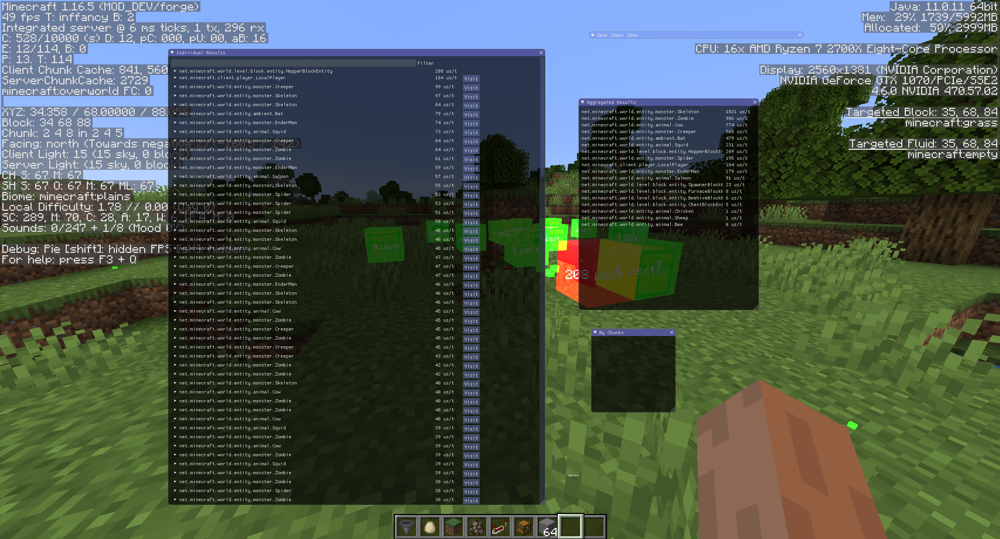

# observable -- see what's lagging your server

This is a spiritual successor to [LagGoggles](https://www.curseforge.com/minecraft/mc-mods/laggoggles) for Minecraft 1.16 - 1.21 (and hopefully later versions). Licensed under MPLv2.

See [CurseForge](https://www.curseforge.com/minecraft/mc-mods/observable) for download links.

# Development notes

The current targets are Minecraft 26.1.2 on Fabric and NeoForge (the latter is
still named `forge` in the project). Install JDK 25 and set `JAVA_HOME` to it, then
run:

```sh
./gradlew :fabric:build :forge:build
```

The distributable jars are written to `fabric/build/libs/observable-5.4.3.jar` and
`forge/build/libs/observable-5.4.3.jar`.

## Historical development notes

Forge 1.18:

- Forge's class loader changes more-or-less require all dependencies to be modules, and some of my dependencies (particularly `kotlin-imgui`) only have non-module builds. While I have patched in my own classloader (which you can enable by setting the environment variable `O_PATCH_LOADER=true`) to have at least partial functionality in a development environment, some things will still have classloader conflicts. In my opinion, you're better off building it into a jar (which will shade all dependencies into the same module) and running it outside the IDE.

Fabric 1.17:

- To run the mod in a development environment, you currently need to set the environment variable `DEV_ENV=1`.

## Credits

- Lucko's [spark-mappings](https://github.com/lucko/spark-mappings) for the deobfuscation mappings I use in the sampler
